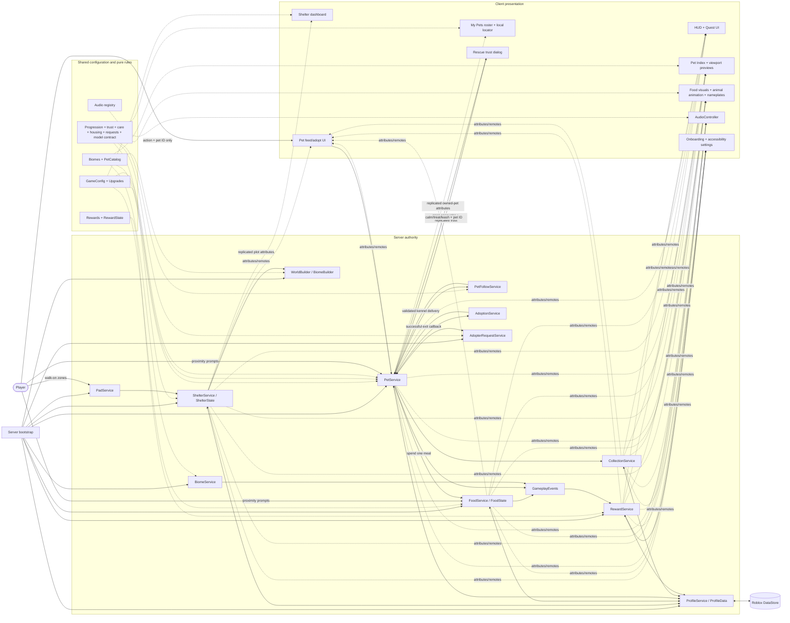

# Code organization and system flow

The existing Rojo code mappings remain `src/server`, `src/client`, and `src/shared`.
Feature modules are grouped by responsibility under those mappings. The extra
`Workspace.ShelterPreview` mapping supplies non-scripted edit-mode scenery; the
server removes it and creates the authoritative runtime world when Play starts.

```text
src/
  server/
    init.server.luau                  # Ordered service startup and remotes
    LegacyWorldCleanup.server.luau     # Live-sync cleanup for retained template slabs
    Common/
      BuildUtil.luau                  # Safe geometry/mounted sign/spawn helpers
      Validation.luau                 # Player, character, finite and range checks
      GameplayEvents.luau             # Server-only quest event bus
    World/
      WorldBuilder.luau               # Map, plots, paths and central plaza
      LegacyWorldCleanup.luau         # Geometry-based obsolete slab detection/removal
      PlotBuilder.luau                # Plot, capacity-linked pet suites and pantry
      BiomeBuilder.luau               # Dog Park, Forest, Orchard and spawn slots
      BiomeService.luau               # Bounded player biome-entry detection
    Shelter/
      ShelterService.luau             # Cash, ownership, capacity and upgrades
      ShelterState.luau               # Pure reservation/capacity ledger
      PadService.luau                 # Server-observed walk-on pads
    Pets/
      PetService.luau                 # Pet records, trust/rescue/feed/adopt authority
      PetBuilder.luau                 # Placeholder/reviewed visuals and stage swaps
      PetModelNormalizer.luau         # Asset audit, root/attachments and rig policy
      PetFollowService.luau           # Shared rescue movement and leash loop
      FollowTrail.luau                # Pure bounded trail history
      CollectionService.luau          # Permanent discovery state
      AdoptionService.luau            # Adopter route, leash and cleanup
      AdopterRequestService.luau     # Rotating preferences and server offer bonuses
    Food/
      FoodService.luau                # Production, collection and spending authority
      FoodState.luau                  # Pure drop/bin/storage ledger
    Players/
      MovementService.luau            # Validated sprint intent
      RewardService.luau              # Dailies, collection rewards and guide state
    Persistence/
      ProfileService.luau             # Load, restore, autosave and departure save
      ProfileData.luau                # Schema validation and session leases
  client/
    init.client.luau                  # Presentation startup only
    UI/
      Components.luau                 # Cards, buttons, badges and progress bars
      PetPreview.luau                 # Catalog viewport previews
    Controllers/
      HUDController.luau              # Compact status, objective and feedback HUD
      QuestController.luau            # Daily/milestone menu and biome banners
      IndexController.luau            # Searchable/filterable Pet Index cards
      MyPetsController.luau           # Owned roster, cooldown filters and local locator
      ShelterDashboardController.luau # Read-only live shelter and upgrade summary
      PetController.luau              # Feed/adopt confirmation and pet feedback
      RescueController.luau           # Calm/treat/leash trust encounter
      FoodController.luau             # Bounded cosmetic conveyor items
      AnimalAnimationController.luau  # One culled procedural animation loop
      PetNameplateController.luau     # Rarity/name/level labels
      MovementController.luau         # Keyboard, gamepad and touch sprint input
      AudioController.luau            # Approved cue registry playback and ambience
      OnboardingController.luau      # Local NEXT marker for server guide steps
      AccessibilityController.luau   # Reduced motion, contrast and text settings
  shared/
    Config/
      GameConfig.luau                 # Economy and gameplay balance
      Biomes.luau                     # Habitat layout, species, weights and caps
      Rewards.luau                    # Daily, milestone and guide definitions
      RewardState.luau                # Pure progress/reset/claim rules
      Audio.luau                      # Categories, volumes and approved asset slots
      ShelterUpgrades.luau            # Upgrade tiers and derived stats
    Pets/
      PetCatalog.luau                 # Definitions, variants, zones and rarity rolls
      PetAssets.luau                  # Replaceable reviewed model registry
      PetModelContract.luau           # Portable model interface and registry checks
      PetGeometry.luau                # Cohesive procedural placeholder descriptors
      PetProgression.luau             # XP, levels, stages and adoption payout
      MovementProfiles.luau           # Species follow and recovery tuning
      AnimationProfiles.luau          # Central rig IDs and procedural fallback states
      AnimalMotion.luau               # Pure acceleration/catch-up/recovery math
      RarityStyles.luau               # Shared rarity colors/order
      PetCare.luau                    # Personalities and bounded care actions
      RescueTrust.luau                # Rarity/personality trust and happiness rules
      PetHousing.luau                 # Species-appropriate suite visual profiles
      AdoptionRequests.luau           # Preference rolls, matches and offer bonus
world/
  ShelterPreview.rbxmx                # Generated, non-scripted edit-mode preview
tests/                                # Pure regression suites and Studio scripts
tools/                                # Preview, tests, asset audit and balance simulation
  release_check.py                    # One-command compile/test/audit/preview/build gate
```

Every public method and named helper has a nearby comment describing its purpose.
Modules expose behavior through a small API instead of sharing their private tables.

## How everything works together

Solid arrows are authoritative calls. Dotted arrows are configuration or replicated
display state. Clients can request actions, but never supply reward, XP, rarity,
ownership, price, food amount, capacity, or timestamps.



## Main flows

**Explore and rescue:** `BiomeBuilder` creates fixed clearings from `Biomes`.
`PetService` rolls only catalog entries allowed by that habitat, rejects a spawn near
a player or pet, and retries later. The rescue prompt validates a loaded, living,
nearby owner with a purchased kennel and available reservation. `PetFollowService`
uses one update loop and species movement profiles to follow the player's recent
ground path. Extreme-distance repositioning happens only after a sustained delay.

**Feed and level:** the client sends `Feed` plus a pet ID. `PetService` validates
ownership, state, range, and the server timestamp, then `FoodService` spends one
stored food. `PetProgression` calculates XP/level/stage; `PetBuilder` swaps only the
visual child while the logical pet ID, owner, rarity, XP, slot, and cooldown remain.
`PetModelNormalizer` re-applies the same root, leash, interaction, orientation,
collision, scale, bounds, movement-profile, and animation-profile contract.

**Pet identity and care:** clients request a known care action, favorite toggle,
or bounded name with a stable pet ID. PetService validates ownership, distance and
state. PetCare owns XP/deadline definitions; Roblox filters published names. Schema
4 saves personality, approved name, favorite and care deadlines.

**Adopt:** the client confirms `Adopt` plus a pet ID. The server locks the pet and
`AdoptionService` moves one bounded NPC along plot waypoints. A Beam leash attaches
at the pet. Cash and capacity change only after the exit callback; timeout, death,
disconnect, or cancellation restores the pet and cleans the NPC/leash.

**Goals and guidance:** committed server gameplay emits events through
`GameplayEvents`. `RewardService` advances the active daily rotation and first-session
guide, publishes display-only goal folders, and validates every claim once. Collection
milestones use permanent discoveries, so adopting a pet never erases progress.

**Saving:** `ProfileService` snapshots cash, shelter, food, owned pets, index, and
reward state on the existing interval and lifecycle hooks. It validates all restored
data and holds a session lease. World pets, in-flight rescues, cosmetic food pieces,
biome presence, and open UI are transient and are rebuilt each session.

## Extension points

- Add a habitat by defining its layout, species set, rarity weights, cap, route,
  respawn timing, ambience key, and future event tags in `Biomes`, then adding its
  build style in `BiomeBuilder`.
- Add a pet through one stable definition and variants in `PetCatalog`; gameplay
  needs no changes. Reviewed visual stages are mapped in `PetAssets`.
- Add an XP source by calling server-only `PetService.AddPetXP` after validating and
  committing that activity. Feeding remains one source, not the progression owner.
- A future flying species can add a `Mode` profile and register one server target
  resolver with `PetFollowService.RegisterMovementMode` before the service starts;
  ownership, trail/leash cleanup, animation state, and rescue logic stay shared.
- Add a quest by defining an event objective in `Rewards` and emitting that event
  only after the authoritative transaction commits.
- Audio IDs remain empty until owned/approved assets are selected. Filling an
  `Audio.Cues` slot activates the existing rate-limited category-volume path.


